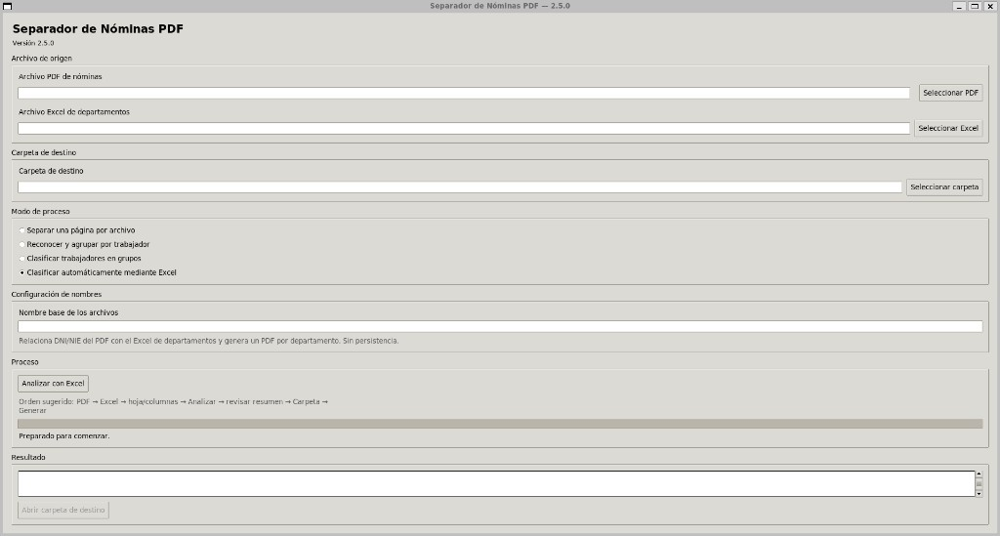

# Separador de Nóminas PDF

Miniaplicación de escritorio para **Windows 10 y Windows 11** que procesa un
PDF multipágina de nóminas en local: separa páginas, agrupa por trabajador o
clasifica por grupos y departamentos.

**Versión actual: 2.5.0**



## Problema que resuelve

La asesoría suele entregar un único PDF donde cada página es la nómina de un
trabajador (a veces varias del mismo). Separar o repartir esas páginas a mano
es lento y propenso a errores.

Esta aplicación permite abrir el PDF, elegir una carpeta de destino y aplicar
uno de los cuatro modos de proceso. Todo se ejecuta **en el equipo del
usuario**, sin subir archivos a un servicio en la nube de la aplicación.

## Descarga para Windows

La versión estable **2.5.0** está publicada en GitHub Releases:

- [Release SeparadorNominas v2.5.0](https://github.com/AntonioZurano/SeparadorNominas/releases/tag/v2.5.0)
  (publicada el 2026-08-02)
- Ejecutable: [`SeparadorNominas-v2.5.0-win64.exe`](https://github.com/AntonioZurano/SeparadorNominas/releases/download/v2.5.0/SeparadorNominas-v2.5.0-win64.exe)
- Checksum: [`SeparadorNominas-v2.5.0-win64.exe.sha256`](https://github.com/AntonioZurano/SeparadorNominas/releases/download/v2.5.0/SeparadorNominas-v2.5.0-win64.exe.sha256)

El archivo `.sha256` sirve para **comprobar la integridad** del ejecutable
descargado (que el fichero no se haya corrompido al transferir). **No** es una
firma digital ni una prueba independiente de autoría. El ejecutable **no está
firmado**; Windows puede mostrar avisos de SmartScreen o del antivirus en
equipos con políticas estrictas.

Manual de uso: [`docs/FUNCIONAMIENTO.md`](docs/FUNCIONAMIENTO.md).
Registro de la publicación: [`docs/PUBLICACION_v2.5.0.md`](docs/PUBLICACION_v2.5.0.md).

## Modos de uso (2.5.0)

| Modo | Qué hace |
|------|----------|
| **Separar una página por archivo** | Genera un PDF por página, con numeración adaptativa y protección ante sobrescritura. |
| **Reconocer y agrupar por trabajador** | Extrae texto local (sin OCR), reconoce el nombre y agrupa páginas con la misma clave normalizada exacta. Pide confirmación antes de escribir. Las no reconocidas van a `No_reconocidas/`. |
| **Clasificar trabajadores en grupos** | Detecta y valida DNI/NIE, consolida páginas por documento y permite crear grupos y asignar trabajadores (sesión en memoria). Exportación separada o conjunta. |
| **Clasificar automáticamente mediante Excel** | Cruza DNI/NIE del PDF con un Excel local (`.xlsx` / `.xls`) de departamentos, crea grupos automáticos y deja sin cruce en `No_clasificadas/`. |

Detalle:

- Clasificación manual: [`docs/CLASIFICACION_NOMINAS.md`](docs/CLASIFICACION_NOMINAS.md)
- Excel departamentos: [`docs/IMPORTACION_EXCEL.md`](docs/IMPORTACION_EXCEL.md)

## Requisitos e inicio rápido (usuario)

- Windows 10 u 11.
- El PDF de nóminas y, si usas el modo Excel, el listado de departamentos.
- No hace falta instalar Python para usar el `.exe` de la Release.

Pasos habituales:

1. Descarga el ejecutable desde la Release v2.5.0.
2. Ábrelo (puede tardar unos segundos al arrancar: empaquetado monofichero).
3. Selecciona el PDF, la carpeta de destino y el modo.
4. Revisa el resumen o la pantalla de clasificación cuando el modo lo pida y
   genera los archivos.

Guía paso a paso: [`docs/FUNCIONAMIENTO.md`](docs/FUNCIONAMIENTO.md).

## Privacidad y tratamiento de datos

- El procesamiento de la aplicación es **local** en el equipo del usuario: no
  hay backend propio ni telemetría en el código de la app.
- Los datos de clasificación (trabajadores, grupos, cruce con Excel) viven en
  **memoria de sesión** y se limpian al cerrar, al limpiar la sesión o al
  cambiar de PDF según el flujo de la interfaz.
- **Sí se escriben** PDF (y carpetas) en la ubicación de destino que elijas:
  ese resultado lo custodia quien usa la aplicación.
- Los registros técnicos no deben incluir el contenido de las nóminas, nombres
  ni DNI; ver política en
  [`docs/SEGURIDAD_Y_PRIVACIDAD.md`](docs/SEGURIDAD_Y_PRIVACIDAD.md).

Este repositorio público contiene **código y documentación**, no nóminas
reales. Quien procese ficheros personales es responsable del tratamiento
conforme al **RGPD** y la **LOPDGDD** (y demás normativa aplicable). La
licencia MIT no sustituye esas obligaciones.

## Limitaciones conocidas

- No realiza OCR: los PDF escaneados sin texto seleccionable no permiten
  reconocer nombres ni documentos de forma fiable.
- No usa coincidencia difusa (*fuzzy*): solo clave de nombre normalizada
  exacta o DNI/NIE según el modo.
- No incluye editor interactivo de coincidencias.
- No envía correos ni se integra con Outlook / Microsoft 365.
- No incluye instalador MSI ni firma digital del ejecutable.

## Tecnologías y arquitectura

| Pieza | Tecnología |
|-------|------------|
| Lenguaje | Python ≥ 3.11 |
| Interfaz | Tkinter |
| PDF | pypdf (sin rasterizar) |
| Excel | openpyxl (`.xlsx`), xlrd 1.2.0 (`.xls`) |
| Pruebas | pytest (+ cobertura configurada) |
| Calidad (opcional en local) | ruff, mypy |
| Empaquetado | PyInstaller → ejecutable Windows |

La interfaz (`gui.py` y vistas) está separada de la lógica de dominio
(servicios PDF, reconocimiento, clasificación, Excel). Detalle de módulos:
[`docs/ARQUITECTURA.md`](docs/ARQUITECTURA.md).

## Desarrollo y pruebas

Entorno recomendado para contribuir o depurar: Windows 10/11 con Python 3.11+
y PowerShell. También se puede desarrollar en WSL/Linux con el mismo código.

```powershell
cd SeparadorNominas
python -m venv .venv
.\.venv\Scripts\Activate.ps1
pip install -r requirements-dev.txt
pip install -e .
.\scripts\run.ps1
```

O, de una vez:

```powershell
.\scripts\run.ps1
```

En WSL / Linux (con el entorno virtual activo):

```bash
python -m separador_nominas.main
```

### Tests

Hay una batería de tests de lógica bajo `tests/` (PDF, agrupación,
clasificación, Excel, privacidad de logs). La GUI Tkinter no forma parte de
esa automatización; existe un checklist manual en
[`docs/PRUEBAS.md`](docs/PRUEBAS.md) y [`docs/PRUEBAS_UI.md`](docs/PRUEBAS_UI.md).

```powershell
.\scripts\test.ps1
```

O:

```powershell
pytest --cov=separador_nominas --cov-report=term-missing
```

Herramientas opcionales (si están instaladas en el entorno de desarrollo):

```powershell
ruff check src tests
mypy
```

No hay workflows de GitHub Actions configurados en este repositorio; la
calidad depende de la ejecución local (por ejemplo, `scripts/test.ps1` o
`scripts/build.ps1` antes de empaquetar).

### Compilación del `.exe` (desarrolladores)

```powershell
.\scripts\build.ps1
```

Resultado esperado en `dist/SeparadorNominas.exe`. Detalles:
[`docs/COMPILACION_WINDOWS.md`](docs/COMPILACION_WINDOWS.md).

## Roadmap resumido

| Versión | Objetivo |
|---------|----------|
| 1.1.0   | Reconocimiento y agrupación por trabajador (**implementada**) |
| 2.0.0   | Clasificación por grupos / DNI-NIE (**implementada**) |
| 2.5.0   | Clasificación automática mediante Excel (**implementada**) |
| 2.1.0+  | Asociación trabajador ↔ correo (CSV/Excel) — **no implementada** |
| 3.0.0   | Borradores de correo con Outlook / Microsoft 365 — **no implementada** |

Detalle: [`docs/ROADMAP.md`](docs/ROADMAP.md). Historial de cambios:
[`CHANGELOG.md`](CHANGELOG.md).

## Estructura del proyecto

```text
SeparadorNominas/
├── AGENTS.md                # Briefing para IAs / agentes
├── CONTRIBUTING.md          # Flujo Git y contribución
├── .cursor/rules/           # Reglas Cursor (contexto persistente)
├── src/separador_nominas/   # Código de la aplicación
├── tests/                   # Tests de lógica
├── assets/                  # Icono y capturas de documentación
├── docs/                    # Documentación (arquitectura, uso, roadmap…)
├── scripts/                 # Scripts PowerShell
├── requirements.txt
├── requirements-dev.txt
├── pyproject.toml
├── VERSION
└── README.md
```

## Contribuir

- `main`: solo versiones estables.
- `development`: integración y pruebas.
- Cada tarea: rama hija de `development` (`feature/…`, `fix/…`, `docs/…`, etc.).
- Merges, tags y pushes: solo con autorización expresa.

Detalle: [`CONTRIBUTING.md`](CONTRIBUTING.md).

## Licencia

Distribuido bajo licencia **MIT**. Consulta el archivo [LICENSE](LICENSE).

Copyright (c) 2026 Antonio Zurano Blázquez.

El software se proporciona «tal cual» (*as is*), sin garantías.

## Para agentes de IA

Si eres un asistente o agente que abre este repositorio, empieza por
**[`AGENTS.md`](AGENTS.md)** (propósito, alcance, roadmap, arquitectura,
privacidad y flujo Git). También hay reglas en
[`.cursor/rules/`](.cursor/rules/) para Cursor. Puntero corto:
[`docs/CONTEXTO_IA.md`](docs/CONTEXTO_IA.md).
